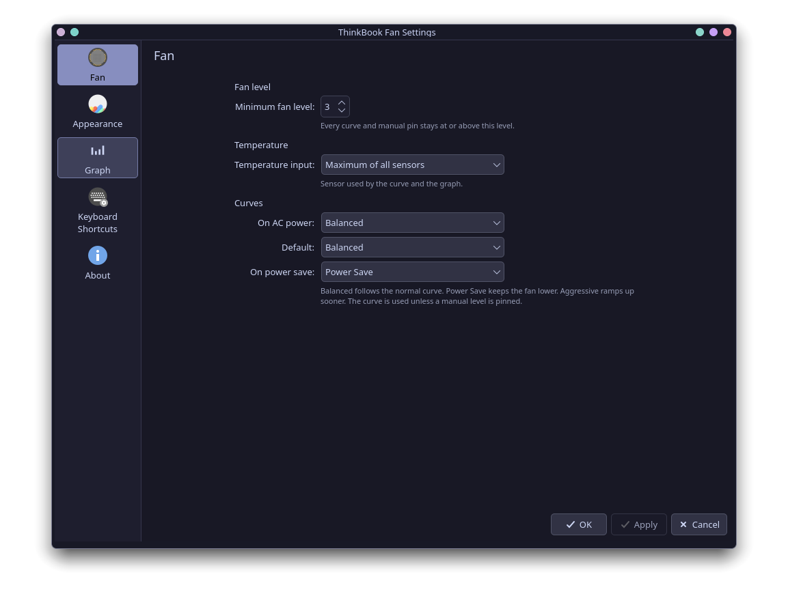
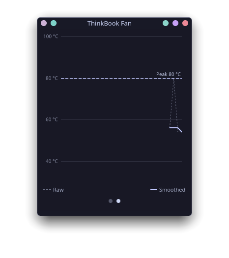
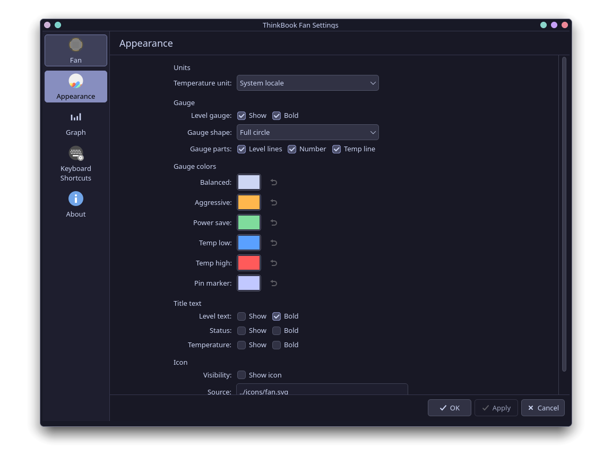

# ThinkBook Fan Widget

[](https://github.com/prbhtkumr/thinkbook-fan-widget/actions/workflows/qml.yml)
[](LICENSE)

Plasma 6 panel widget for the standalone `thinkbook-fan` service on a Lenovo
ThinkBook 15 G2 ITL.



The widget shows the current fan level as a dual ring gauge and shows whether the service is on AC, on battery, or pinned. The inner segmented ring is the fan level, the outer arc is temperature, and a dot marks a pinned level. Click it to open the level menu. Scroll over it to move one level. Selecting Auto returns control to the AC/battery curve.

## Requirements

- Plasma 6
- Lenovo ThinkBook 15 G2 ITL
- `thinkpad_acpi` with `fan_control=1`
- Python 3.11 or newer for the service

The fan controls are specific to this laptop. Other models may expose different EC registers.

## Install

### Service

This widget is a client for the [standalone thinkbook-fan service](https://github.com/prbhtkumr/thinkbook-fan).
Install and configure that project first, then enable its service. The two
exchange state through `/run/thinkbook-fan`, so the widget does not bundle a
daemon.

Stop and disable any older fan service before starting the new one.

### Widget

```bash
kpackagetool6 --type Plasma/Applet --install .
```

Open the panel context menu, choose Add Widgets, and search for ThinkBook Fan.

## Use

- Left click: open the popup. Swipe or scroll horizontally between the Control and Graph pages.
- Scroll up or down over the widget: change the fan level one step.
- Middle click: release the pinned level and resume the active curve.
- Pick 0 to 7: pin that level.
- Pick a curve: follow that curve and remove any pin.

When a level is pinned, the curve buttons lose their highlight. The pinned level is the only active control.

The popup status card shows level, mode, and temperature. The tooltip adds the commanded level, applied minimum, and watchdog when the service provides them.

The compact title can show the icon, level gauge, level text, status, and temperature. The gauge is on by default and the level text is off, so the title starts with just the graphic level indicator. Enable Level text in Appearance to show `L3` as well. The gauge shows the level inside the center and fills the inner ring with the same curve color. It fills the available compact height with no widget padding, so a thicker panel gives a larger gauge and a thinner panel scales it down. The center number and the filled level lines are neutral on Balanced, amber on Aggressive, and green on Power save. The outer ring runs from blue at 30 C to red at 100 C. The gauge shape can be a full circle, which starts at the bottom and runs clockwise, or an arc with an open bottom. The level lines, number, and temperature line can each be turned off. When one is off, the remaining parts get thicker, and the number gets larger and bold when the level line is off. The tooltip shows the selected temperature in the selected unit.

## Curves

Three presets are available:

- Balanced: balanced response
- Power Save: quieter, with higher temperature thresholds
- Aggressive: earlier ramp and higher levels

In Settings, choose which preset applies to each power state:

- On AC power
- Default, meaning on battery
- On power save, meaning the platform profile is low-power or the battery is at or below 20 percent

The active curve is shown in the popup and tooltip. The popup curve buttons change the curve for the current power state and remove any manual pin. The compact display shows the status as `AC`, `BAT`, or `PWR` when status is enabled.

## Graph



The Graph page shows the configured history window. The default is 60 seconds. The dim line is the raw reading and the highlighted line is the smoothed value used by the curve. Either line can be hidden, and each can be solid, dashed, or dotted. The guide lines, peak line, legend, and an area fill under the smoothed line can also be turned off or on. The history resets when you change the input.

## Settings



Right click the widget and choose Configure. The settings are grouped into pages:

- Fan: minimum fan level, 0 to 7, temperature input, and the curve preset for AC power, Default, and Power save. The minimum level clamps manual pins and every curve. Level 0 stops the fan; the service still raises it near the safety limit.
- Appearance: temperature unit, gauge visibility, shape, parts, and colors, Show and Bold options for the title text, and the icon visibility and source.
- Graph: history duration, Show and line style for the raw and smoothed lines, overlays, and color pickers for the lines, fill, peak, and guides.

The temperature input selects what the curve and graph use:

- Maximum core: highest individual core.
- Average core: average of all core sensors.
- Package: package sensor.
- Maximum of all sensors: highest of cores, package, and TCPU. This is the default.

The temperature unit defaults to the system locale. A changed unit is saved.

The widget writes the minimum level to `/run/thinkbook-fan/min-level`, the curve selection to `/run/thinkbook-fan/curves`, and the input selection to `/run/thinkbook-fan/input`. The service reads them within 2 seconds.

## How it works

The service writes `/run/thinkbook-fan/state` every 2 seconds. The widget reads that file with the Plasma executable data engine. Changing the level writes `/run/thinkbook-fan/pin`. The service reads the pin file and writes the level to `/proc/acpi/ibm/fan`.

The curve file contains one line per power state:

```text
ac=auto
default=auto
power-save=power-save
```

Balanced is stored as `auto` in this file.

The service uses the selected temperature input, takes the median of the last three samples for curve decisions, and moves the fan one level per poll. A single short spike does not move the fan. The raw and smoothed values are reported in the state and used by the graph.

The widget keeps samples for the configured graph duration. The default is 60 seconds.

The service creates `/run/thinkbook-fan` as group writable. Set `paths.state_group` in the service configuration if your desktop user is not in the `users` group.

## Notes

- Fan RPM and actual EC level read-back are not exposed on this machine. The service and widget are write-only for fan control.
- Stopping the service writes `level auto` back to the EC.
- If the pin file cannot be written, the widget shows the error in the popup.

## Uninstall

```bash
kpackagetool6 --type Plasma/Applet --remove io.github.prbhtkumr.thinkbookfan
```

Disable and remove the service from the `thinkbook-fan` project if you no
longer need it.

## License

MIT
